<a href="https://dominiknagy.dev"></a>

Applied AI developer in Gothenburg. I turn complex problems into understandable systems, and I build them hands-on, from the first sketch to the tests that prove they work.

Right now I'm at [TakScan](https://takscan.com) with Alex Weibull, building the AI system that helps experts inspect drone imagery of buildings, with a person confirming every conclusion. It's a confidential pilot, so the code and results stay private.

## Projects

### [dominiknagy.dev](https://dominiknagy.dev)

Portfolio website · [Visit the site](https://dominiknagy.dev) · [Source](https://github.com/Xentiles/portfolio)

My portfolio, in English, Swedish and Hungarian. It's built with Astro and a hand-written WebGL ink field: the page is drawn in small capsules of ink that drift, react to your cursor, and part around an orange moon on its orbit. The look comes from my own design style, Orbital Clarity, and the typeface is Libron by Nico Verbruggen. The site has the full case studies, my thesis and how I got here.

<br>

### [Feedback Intelligence](https://github.com/Xentiles/feedback-intelligence)

Local web app, v0.2.0 · [Repository](https://github.com/Xentiles/feedback-intelligence) · [Walkthrough](https://github.com/Xentiles/feedback-intelligence/blob/v0.2.0/docs/demo-walkthrough.md) · [Release review](https://github.com/Xentiles/feedback-intelligence/blob/v0.2.0/docs/quality/v0.2.0-release-review.md) · [Case study](https://dominiknagy.dev/work/feedback-intelligence/)

A local workbench that imports reviews and comments, classifies them with keyword rules or connected AI, and keeps every decision traceable to its evidence. You can save datasets, edit classification templates, compare runs and export the records behind each number. It runs locally in Docker: a React front end, an ASP.NET Core API over PostgreSQL, a Python worker that redacts personal data before classifying, and a ClickHouse projection for the trends.

[](https://github.com/Xentiles/feedback-intelligence/blob/v0.2.0/docs/workbench.md)

Jobs survive retries and worker restarts, so a 10,000-record run finished after a restart with every export counted. That shows the workflow recovers. It doesn't claim anything about AI accuracy, and the app asks for consent before any feedback is sent to an external model.

<br>

### [NotchQ](https://github.com/Xentiles/NotchQ)

Native macOS app, beta · [Repository](https://github.com/Xentiles/NotchQ) · [Download Bv0.5.0](https://github.com/Xentiles/NotchQ/releases/tag/Bv0.5.0) · [Case study](https://dominiknagy.dev/work/notchq/)

Running out of AI allowance in the middle of a task breaks your flow, and checking how much is left means leaving what you're doing. NotchQ (notch + quota) keeps it in view: a native Swift and AppKit app that shows your remaining Codex and Claude allowance beside the MacBook's camera notch, with reset times and how fresh each reading is. When a limit runs low, its figure blinks and a small reminder card drops from the notch.

<a href="https://github.com/Xentiles/NotchQ"></a>

It updates itself from GitHub releases and checks each download's signature first, recovers after sleep and wake, and its parsing is covered by fixture tests. The beta is ad-hoc signed, not notarized by Apple. The readings in the clip are illustrative.

<br>

### NexaCam

Windows desktop app, alpha · Private repository: the code isn't public, but here is how it's built.

Real-time AI background replacement for webcams on Windows. NexaCam takes a camera feed, separates the person from the background with Robust Video Matting, composites a new background, and sends the result to a virtual camera that Teams, Zoom or OBS can use. Python, ONNX Runtime on CUDA, OpenCV and PyQt5.

```text
Windows camera
  -> named device discovery (DirectShow / Media Foundation)
  -> OpenCV capture, first-frame validation
  -> preprocessing into tensors
  -> RVM matting on ONNX Runtime + CUDA, with recurrent state between frames
  -> alpha compositing onto the chosen background
  -> Qt preview  +  virtual camera output
```

Most of the work went into the parts that make webcam software hard in practice:

- The inference stack starts and proves it can run on the GPU before Qt or the camera open, so a CUDA problem is never misreported as a camera problem.
- If CUDA isn't really running, NexaCam says so instead of quietly dropping to the CPU. CPU mode exists, but only when you ask for it.
- Capture, inference and virtual-camera output run in one worker thread, and the Qt interface only sends input and shows frames and status.
- Cameras are remembered by name and backend rather than by a Windows index that shifts. A missing camera is left unselected instead of being swapped for the wrong one.
- Separate probe scripts test the camera, the runtime, CUDA execution, the model and the virtual camera one at a time, and logs are structured JSON.

It's an alpha. Capture, matting, preview, diagnostics and virtual-camera output work, with CI, linting and unit tests. Packaging and wider hardware testing are still in progress.

<br>

### Wash Dial

Django web app · Private repository: the code isn't public, but here is how it's built.

A booking website that replaces the paper timetable in an apartment building's laundry room. Residents scan a QR code in the basement, sign in once, and book or cancel a wash time from their phone. The building owner manages schedules, access and support from an operator portal. Python and Django on SQLite, so it can run on a small computer in the building.

```text
QR code in the laundry room
  -> building landing page
  -> resident account + apartment access request
  -> owner approves -> single-use activation link by email
  -> calendar: book or cancel in the current and next month
operator portal
  -> weekly schedule rules -> slots generated over a rolling 2-12 month horizon
  -> access requests, support tickets, move-out and deletion requests
  -> append-only audit log -> integrity-checked export
```

- It keeps the four time windows from the old Swedish paper sheet, and the "two bookings a week" guideline is shown but not enforced, so residents can still book an extra time in an emergency.
- Other residents only see whether a time is free, never who booked it. Owners only see the buildings assigned to them. The data collected and who can see it are written down as privacy commitments.
- Bookings and admin actions go into an append-only audit log, and its exports are checked for integrity. Moving out or deleting an account keeps the records the building is required to keep.
- In development, emails are written to local files and never sent, and real delivery has to be switched on deliberately.

## How I build

Scope, plan, interfaces and tests, build, verify. I use Codex, Claude and local models to explore and speed up the work, but I direct the tasks, read every change, debug the failures and own the decisions. Generated code is a draft until the tests and I agree.

I work mostly in Python, TypeScript and React, C# / ASP.NET Core, Swift, SQL, PostgreSQL and ClickHouse, with Docker and GitHub Actions around them.

## Also

My bachelor's thesis, [Context-Based Image Learning](https://urn.kb.se/resolve?urn=urn:nbn:se:hh:diva-59395) (Halmstad University, co-authored), built a traceable computer-vision pipeline that learns a library of visual concepts and reuses them.

[OSFR](https://github.com/Xentiles/OSFR) is rendering research in Unity, testing shader ideas with measurements. [Mining Turtle](https://github.com/Xentiles/CC-Tweaked---Cylinder-Mining-Turtle-V3) is Lua automation for a Minecraft robot, with path planning and remote status.

## Contact

I'm open to full-time roles in applied AI, automation and software, with a team that values curiosity, clear communication and work that can be inspected and improved. I speak Swedish, Hungarian and English.

[dominiknagy.dev](https://dominiknagy.dev) · [LinkedIn](https://www.linkedin.com/in/dominik-nagy-841002144/) · [X](https://x.com/Xentiles1) · [Email](mailto:domisweden@gmail.com)
